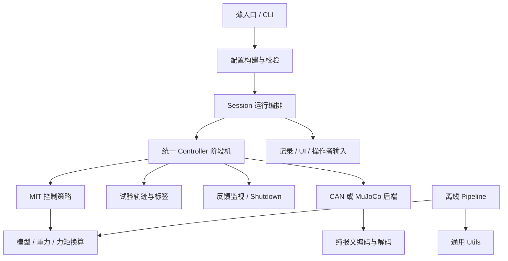

# PiPER 代码架构

## 层次与依赖

业务源码集中在 `src/piper_dynamics`。core 不导入实机运行入口，utils 不反向依赖业务；控制器不导入具体 MIT 控制器或具体仿真类。根目录旧模块通过转发引用同一对象，兼容接口不承载第二套逻辑。

## 运行职责

| 模块 | 职责 |
| --- | --- |
| `real_robot/cli.py` | 参数定义、模式组合检查、纯手柄校准/监视 |
| `real_robot/configuration.py` | 按原顺序覆盖配置、分任务校验 |
| `real_robot/app.py` | Session 资源生命周期、后端构建、控制循环、记录输出和收尾 |
| `real_robot/controller.py` | 准备/测试/停止/回位状态转换，分开的反馈检查与状态处理函数 |
| `real_robot/control/mit_mode.py` | MIT 命令、前馈渐变、停止参考接管和释放处理 |
| `real_robot/control/mit_trial.py` | MIT 任务配置及旧接口导出 |
| `real_robot/control/impedance.py` | 协议 PD 单位下的无扰参考计算 |
| `real_robot/backends/` | 位置、MIT、仿真后端的实际命令接口 |
| `real_robot/protocol/` | 不打开设备的编码、量化和反馈解码 |
| `real_robot/trials/` | pilot、多正弦、验证、摩擦任务及构建 |
| `real_robot/recording.py` | TESTING 专用采样、质量标记与导出 |
| `core/model.py`、`gravity_model.py`、`torque.py` | PiPER 模型、线性重力计算、参考换算系数 |

## 当前控制语义

当前实现是重构基线，不能用旧文档或 main 的离线实现替换它。

- MOVE J 和 MIT 保留各自入口约束；MIT 准备、测试、回收仍全程使用 MIT。
- 默认六轴 Kp=10、Kd=0.8，保留 gain_scale 规则；MIT 准备与回位窗口为 8°，普通失能释放窗口仍单独配置。
- 状态链覆盖 WAITING、ARMING、必要的 BOUNDARY_ENTRY、PREPARING、SETTLING_READY、READY、TESTING、BRAKING、RETURNING、SETTLING_HOME、DISABLING、DONE。
- MIT 保留 FF_RAMP_IN、FF_RAMP_OUT 与实机刚度释放阶段；仿真通过后端能力声明保留原直接失能行为。
- 告警、持续越限制动与真实故障处理保持当前实现；异常退出继续经过原有停放/失能确认，不跳过收尾。
- 启动姿态、实测边界、规划边界与回位目标保持各自语义，未合并成一个宽松阈值。
- 原 gravity hold 的实机入口仍按原实现退役，保留其仿真与历史接口，未因解耦而重新开放。

## 文件与来源

路径集中在 `paths.py`。模型唯一来源为 `models/standard_piper`；旧 `real_robot/assets/` 路径是别名，历史模型指纹按逻辑路径映射到相同文件字节核验，不改写旧修订。

`runs/<时间戳>/` 保留 config、reference_plan、hardware、events、samples、result 及 TESTING 专用数据。采样窗口、字段和单位保持兼容。离线输出放 `outputs/`；相邻 `identification/` 的实验索引、active_revision 与修订归档继续复用。

官方协议参考保存在 `tests/fixtures/mit_official`，源文件、哈希和许可证保持原字节，仅供 PiPER 编码对照。共享网格保留；X 专用源码、模型和历史结果的删除记录见 `docs/removed_x_files.json`。
