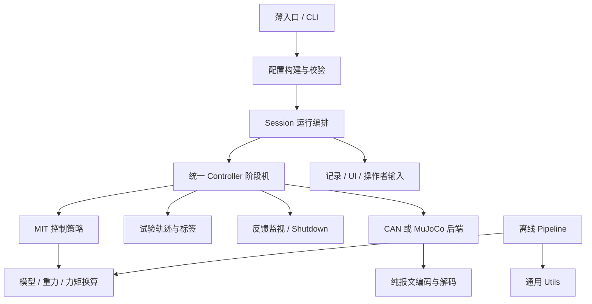

# PiPER 仓库结构与代码架构

更新日期：2026-11-05。本文描述当前实现；顶层沿用已合入 main 的管理方式，控制行为以重构前本分支的普通 PiPER 实现为基线。开发规则见 [代码规范](CODING_STANDARD.md) 和 [项目约定](AGENTS.md)。

## 仓库目录

以下省略缓存、生成文件和单次实验的具体内容；`runs/` 是本地采集目录，由 Git 忽略。

```text
Piper_dynamics_identification/
├── src/piper_dynamics/           唯一业务源码
│   ├── __main__.py / cli.py      离线命令入口
│   ├── paths.py                 仓库、模型、配置、记录和归档路径
│   ├── core/                    辨识、模型和数据领域算法
│   ├── pipeline/                离线流程编排与报告
│   ├── real_robot/              控制、运行与设备接口
│   └── utils/                   通用哈希、序列化和绘图
├── scripts/                     薄启动脚本、解释器选择和文档绘图工具
├── tests/
│   ├── real_robot/              控制、通信、分析、会话和兼容测试
│   └── fixtures/                行为基线与官方协议参考
├── inputs/
│   ├── raw/standard_piper/      原始轨迹及来源记录
│   ├── train/                   训练输入
│   ├── validation/              留出验证输入
│   └── friction_runs.json       既有摩擦采集记录的索引
├── models/
│   ├── standard_piper/          PiPER URDF、MuJoCo XML、名义参数和夹爪描述
│   └── collision_meshes/        PiPER 使用的共享碰撞网格
├── outputs/                     离线参数、指标、图表和报告
├── runs/                        每次实机/仿真会话的原始记录
├── docs/                        使用说明、迁移、删除审计和验收记录
├── real_robot/                  四个归档模块、pilot与资源路径的最小兼容层
├── pyproject.toml               包、可选依赖、命令和检查配置
├── requirements.txt             已验证的基础运行依赖
├── README.md                    项目说明与常用命令
├── ARCHITECTURE.md              本文：目录、职责与依赖边界
├── CODING_STANDARD.md           人可阅读、可执行的代码规范
└── AGENTS.md                    后续修改必须沿用的项目约定
```

相邻 `../identification/` 继续负责实验索引、active_revision、修订和验证归档，不在本仓库建立第二份归档库。原始输入、模型字节、真实采集和已有修订不因源码整理而改写。

## src 内部职责

省略各包的 `__init__.py`。同一行的多个文件表示同一职责组，实际仍是独立文件。

```text
src/piper_dynamics/
├── core/
│   ├── dataset_io.py / excitation.py             数据读取与激励
│   ├── model.py / regression_model.py            模型加载与回归模型
│   ├── rigid_body_regressor.py                   刚体回归器
│   ├── trajectory_metrics.py                    轨迹范围、停留与信息量指标/共同基适配
│   ├── gravity_model.py / torque.py              重力与力矩换算
│   ├── least_squares.py / svd_fit.py              原 QR 求解与 main SVD 求解
│   └── parameter_schema.py / parameter_report.py 参数定义与输出
├── pipeline/
│   ├── standard_piper_pipeline.py                main 辨识流程
│   ├── trajectory_split.py / trajectory_design.py 轨迹划分与设计
│   ├── measured_run.py                          既有实测记录分析
│   ├── trajectory_audit.py / trajectory_audit_report.py 既有激励审计与图表报告
│   ├── run_summary.py / export_signals.py         摘要和信号导出
│   ├── friction_combined.py / friction_bins.py   摩擦分析
│   └── friction_final.py / friction_paths.py     摩擦分析及路径选择
├── real_robot/
│   ├── entries/                                 MIT / MOVE J 薄入口
│   ├── cli.py / configuration.py                 参数与配置校验
│   ├── app.py                                   Session 生命周期和循环编排
│   ├── controller.py                            统一控制阶段机
│   ├── control/                                 MIT 策略、阻抗与历史重力接口
│   ├── backends/                                CAN、MIT 与仿真后端
│   ├── protocol/                                纯报文编码和反馈解码
│   ├── trials/                                  轨迹、摩擦、多正弦和验证任务
│   ├── profiles/                                当前控制配置与多正弦配置
│   ├── monitoring.py / shutdown.py              反馈监视与停机收尾
│   ├── recording.py / session_history.py         记录、导出与历史会话
│   ├── current_pose.py / standing.py             姿态读取与启动姿态检查
│   ├── gamepad.py / ui.py / operator_exit.py      操作者交互
│   └── protocol_read.py                         离线报文读取
└── utils/
    ├── hashing.py                               通用哈希
    ├── serialization.py                         通用序列化
    └── plotting.py                              通用绘图辅助
```

新增代码按职责归位：可复用的辨识/模型算法放 core，离线流程放 pipeline，控制业务放 real_robot，不依赖业务的公共工具放 utils。函数围绕完整职责拆分，不为减少行数而制造无意义转发；控制入口负责组织调用，算法、设备操作和文件输出由对应模块承担。

## 层次与依赖



依赖方向遵循以下约束：

- CLI/Session 组织运行，Controller 组织阶段转换，具体策略、任务和后端实现各自职责。
- core 不依赖实机入口；utils 不反向依赖 core、pipeline 或 real_robot。
- 报文编码/解码不打开设备，离线分析不通过启动实机会话来读取记录。
- MIT 策略仍与统一阶段机协作，共享必要的运行状态；本轮移除了双向导入，没有引入插件框架或宣称模块之间完全没有依赖。

业务源码集中在 `src/piper_dynamics`。core 不导入实机运行入口，utils 不反向依赖业务；控制器不导入具体 MIT 控制器或具体仿真类。根目录保留的四个旧归档模块通过转发引用同一对象，兼容接口不承载第二套逻辑；其余无调用方的转发已删除。

## 运行职责

| 模块 | 职责 |
| --- | --- |
| `real_robot/cli.py` | 参数定义、模式组合检查、纯手柄校准/监视 |
| `real_robot/configuration.py` | 按原顺序覆盖配置、分任务校验 |
| `real_robot/app.py` | Session 资源生命周期、后端构建、控制循环、记录输出和收尾 |
| `real_robot/controller.py` | 准备/测试/停止/回位状态转换，分开的反馈检查与状态处理函数 |
| `real_robot/control/mit_mode.py` | MIT 命令、前馈渐变、停止参考接管和释放处理 |
| `real_robot/control/mit_trial.py` | MIT 任务配置及旧接口导出 |
| `real_robot/control/impedance.py` | 协议 PD 单位下的无扰参考计算 |
| `real_robot/backends/` | 位置、MIT、仿真后端的实际命令接口 |
| `real_robot/protocol/` | 不打开设备的编码、量化和反馈解码 |
| `real_robot/trials/` | pilot、多正弦、验证、摩擦任务及构建 |
| `real_robot/recording.py` | TESTING 专用采样、质量标记与导出 |
| `core/model.py`、`gravity_model.py`、`torque.py` | PiPER 模型、线性重力计算、参考换算系数 |

## 当前控制语义

当前实现是重构基线，不能用旧文档或 main 的离线实现替换它。

- MOVE J 和 MIT 保留各自入口约束；MIT 准备、测试、回收仍全程使用 MIT。
- 默认六轴 Kp=10、Kd=0.8，保留 gain_scale 规则；MIT 准备与回位窗口为 8°，普通失能释放窗口仍单独配置。
- 状态链覆盖 WAITING、ARMING、必要的 BOUNDARY_ENTRY、PREPARING、SETTLING_READY、READY、TESTING、BRAKING、RETURNING、SETTLING_HOME、DISABLING、DONE。
- MIT 保留 FF_RAMP_IN、FF_RAMP_OUT 与实机刚度释放阶段；仿真通过后端能力声明保留原直接失能行为。
- 告警、持续越限制动与真实故障处理保持当前实现；异常退出继续经过原有停放/失能确认，不跳过收尾。
- 启动姿态、实测边界、规划边界与回位目标保持各自语义，未合并成一个宽松阈值。
- 原 gravity hold 的实机入口仍按原实现退役，保留其仿真与历史接口，未因解耦而重新开放。

## 文件与来源

路径集中在 `paths.py`。模型唯一来源为 `models/standard_piper`；旧 `real_robot/assets/` 路径是别名，历史模型指纹按逻辑路径映射到相同文件字节核验，不改写旧修订。

`runs/<时间戳>/` 保留 config、reference_plan、hardware、events、samples、result 及 TESTING 专用数据。采样窗口、字段和单位保持兼容。离线输出放 `outputs/`；相邻 `identification/` 的实验索引、active_revision 与修订归档继续复用。

官方协议参考保存在 `tests/fixtures/mit_official`，源文件、哈希和许可证保持原字节，仅供 PiPER 编码对照。共享网格保留；X 专用源码、模型和历史结果的删除记录见 `docs/removed_x_files.json`。

## 兼容层与后续维护

根目录`real_robot/`仅保留identify_offline、designed_trajectory、design_trajectories、simulation四个模块别名、pilot.sh、包引导和资源路径。已删除其余无实际调用方的转发、旧test_*.sh、tools和excitation.py。历史模块对应关系仍见[迁移清单](docs/source_migration.json)，该表不表示旧文件继续存在。相邻归档工具及默认资源路径迁移前，暂留这组最小兼容层。

后续新增、移动或删除模块时，同步修改本文目录树、README 的目录索引和受影响的调用说明；保持现有 inputs、models、outputs、runs 及外部归档职责。

## 本轮完成情况与验证边界

已完成此前批准的结构迁移、主要函数与模块职责拆分、公共算法/工具复用、路径配置化、模型统一、X 专用内容清理，以及默认摩擦轴序校验和帮助说明修复。基础依赖中的 MuJoCo 版本统一为已验证的 3.8.1，未升级现有控制环境。

最近一次代码验收为 206 项测试通过；4 组仿真场景合计 11,258 个控制周期与基线对照一致；main 拟合结果在浮点误差范围内一致。70 个活动 Python 模块的显式导入检查未发现循环依赖。详细证据和范围见 [验收报告](docs/refactor_report.md) 与 [验证记录](docs/refactor_verification.json)。

这些结果覆盖静态检查、离线分析、数值复算和仿真。本轮没有执行实机动作测试，也没有重新完整运行 Pinocchio 轨迹优化。报告/流程函数中职责连续的较长函数仍可按后续实际需求细化；本轮完成不意味着所有函数都缩短到固定行数，或已排除所有潜在缺陷。

## 2026-11-05 激励评价入口

`pipeline.trajectory_audit`只读取既有记录与归档，复用`paths.py`、共同惯性基、模型与哈希工具。
`core.trajectory_metrics`承担范围、速度停留、SVD信息与Stribeck局部敏感度数值指标；
其Pinocchio列顺序适配同时被既有轨迹设计器复用，保持同一矩阵计算实现。
图表、CSV和报告由`trajectory_audit_report`输出到`outputs`；不修改采集、模型、控制参数或数据划分。


## 2026-11-06 工作区整理的控制基线

本次整理遵循用户“保持原有具体控制逻辑”的要求。测试段维持Kp=2、Kd=0.15、名义重力前馈100%；准备/回位/急停保留基础10/0.8及既有三秒渐变与阶段顺序。
拖动命令范围继续使用固件上下界分别向内1°、再按需覆盖启动home的实现；测量及启动的10°容差是另一路校验，不会自动扩展MIT命令范围。该现状与此前“覆盖整个固件范围”的约定差异已明确记录，本次不修改边界或监视阈值。
规范、Agent约定、本结构说明和规范副本仅供开发分支使用，正式main交付须显式排除其分支变更。


## 2026-11-06 简单兼容入口清理

本次从原50个兼容层文件/链接中移除36个，保留14个。删除的是无外部实际调用方的24个Python转发、6个旧测试shell、3个旧摩擦工具、excitation别名、旧测试目录链接及重复requirements。测试里旧run的patch路径改为同一正式模块，恢复确认断言保持。

保留归档导入、轨迹复现入口、指纹文件、配置/模型软链接和本地手柄标定；不迁移相邻归档，不改历史记录，不改数值参数、限位、渐变或控制阶段。
